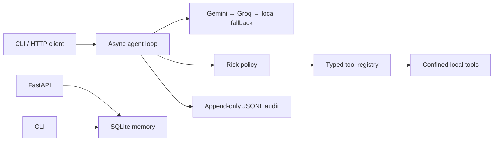

# Jarvy

Jarvy is a local-first, permission-aware personal assistant foundation. The runnable foundation includes optional Gemini and Groq-compatible routers, a no-key local time demo, a typed plugin registry, bounded tool execution, local SQLite memory, an append-only redacted audit log, confined file tools, optional Playwright browsing, a CLI, and a local chat UI/API.

## Stack decisions

- **Python 3.11+, asyncio, FastAPI, Pydantic Settings** for a compact typed backend that runs on Windows, macOS, and Linux.
- **Gemini REST + OpenAI-compatible `httpx` adapter** instead of provider SDKs: Gemini is primary, optional Groq-compatible Chat Completions can be fallback, then local-only behavior. Both cloud providers are optional.
- **SQLite** for local memory and **JSONL** for local audit events; no remote data store or embeddings are enabled in this baseline.
- **Dependency-free static chat UI** served by FastAPI, alongside the CLI. The API defaults to loopback; configure a protected reverse proxy before network exposure.

## Quick start

```bash
./scripts/setup.sh                 # macOS / Linux
# Windows PowerShell: .\\scripts\\setup.ps1
# Edit .env: set GEMINI_API_KEY and/or GROQ_API_KEY (optional), plus JARVY_ALLOWED_DIRS.
source .venv/bin/activate           # Windows: .\\.venv\\Scripts\\Activate.ps1
jarvy chat
```

Try `What time is it?` without a key. The built-in reminder form/API works without an LLM key; reminders persist locally and show in the UI while the server is running. The page-watch form monitors public HTML/text pages every 5 minutes to 24 hours and alerts when page text changes (it doesn’t access logged-in pages). The assistant also has memory tools to `remember_fact` (only when explicitly asked), `recall_memory`, and `forget_memory` (confirmation required). With Gemini or Groq credentials, Jarvy can use general reasoning and the memory/file tools; `web_search` with Google grounding and citations specifically requires Gemini. If both providers are configured, Groq is tried after Gemini errors. Optional Playwright browser tools support public-page reading, exact-name clicks, labelled form filling, and bounded downloads into the configured allowed folder (click/fill require T2 approval; fill does not submit; downloads are capped at 25 MiB): install with `pip install -e '.[browser]'` then `python -m playwright install chromium`. The UI streams live planning/tool-step status over SSE; final model text arrives when the provider finishes. File operations are restricted to `JARVY_ALLOWED_DIRS`; the create tool refuses overwrites. T3 actions are denied by policy.

Optional Google Workspace tools provide Gmail search/read/draft/send, primary-calendar event list/create, and Drive search/read-text/create-text. To connect, install `pip install -e '.[integrations]'`, create a Google OAuth **Desktop app** client in Google Cloud with Gmail API and Calendar API enabled, then run `jarvy connect-google /path/to/client_secret.json` and approve the scopes in your browser. Tokens are stored in your OS keyring; `jarvy disconnect-google` removes the local token. Sending mail and creating events require exact-action T2 approval. Live OAuth/API calls need your own client and consent and were not tested in this sandbox.

To run the local chat UI and API: `jarvy serve`, then visit `http://127.0.0.1:8000/` (API docs at `/docs`). The UI streams planning and tool-step status over SSE; final model text arrives after the provider finishes. Endpoints include `GET /health`, `POST /chat`, `POST /chat/stream`, and local memory/reminder/page-watch APIs. Do not expose this API to an untrusted network. Docker usage: mount a host directory at `/data`, set `JARVY_ALLOWED_DIRS` to its container path, and pass `GEMINI_API_KEY` and/or `GROQ_API_KEY` as runtime secrets (never bake them into the image).

## Repository structure

```text
jarvy/
  brain/       Gemini/local router and bounded perceive-plan-act loop
  core/        settings and dependency composition
  interface/   CLI and FastAPI endpoints
  memory/      local SQLite profile + episodes
  safety/      risk authorization and redacted audit log
  tools/       typed registry, confined local tools, grounded web search
scripts/       one-command Python setup
 tests/        foundation unit and integration tests
 docs/         architecture, security, and extension guides
```

## Verification

```bash
pytest -q
```

## Architecture



See [docs/SECURITY.md](docs/SECURITY.md) and [docs/TOOL_AUTHORING.md](docs/TOOL_AUTHORING.md). Remaining gaps include voice/wake-word, desktop control, OS notifications, recurring reminders, semantic/vector memory, and production API authentication. Current support and gaps are tracked in `docs/ROADMAP.md`.
